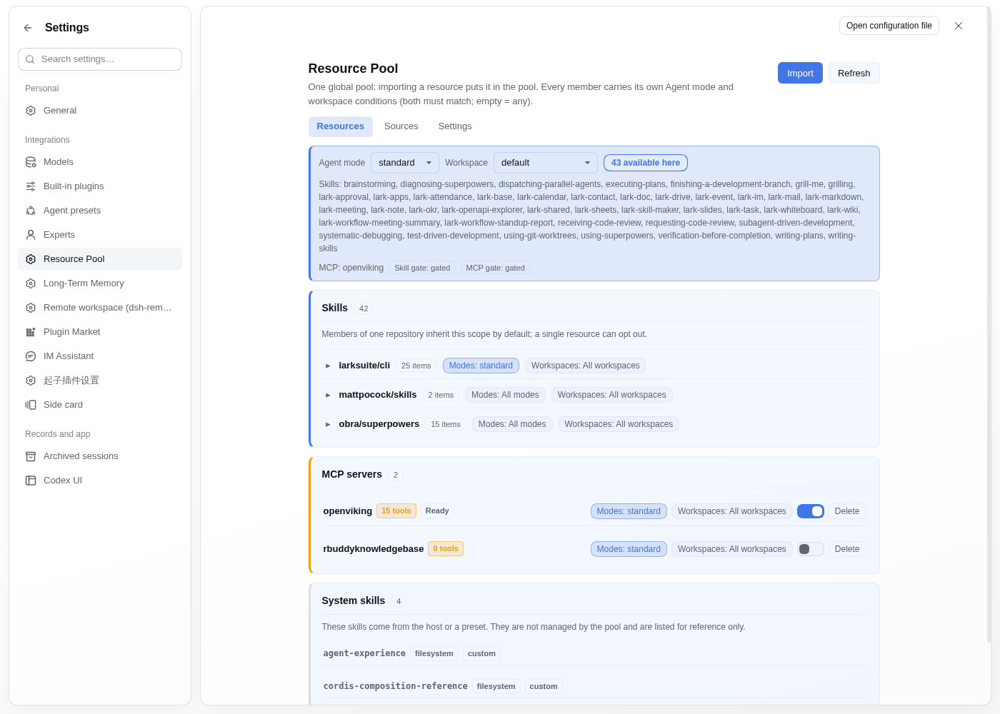
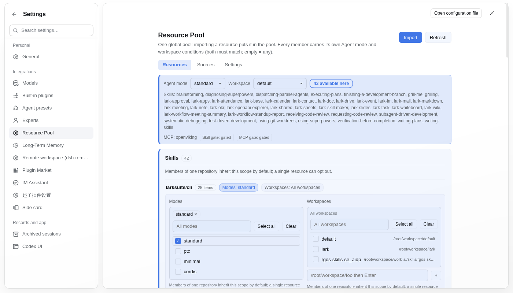
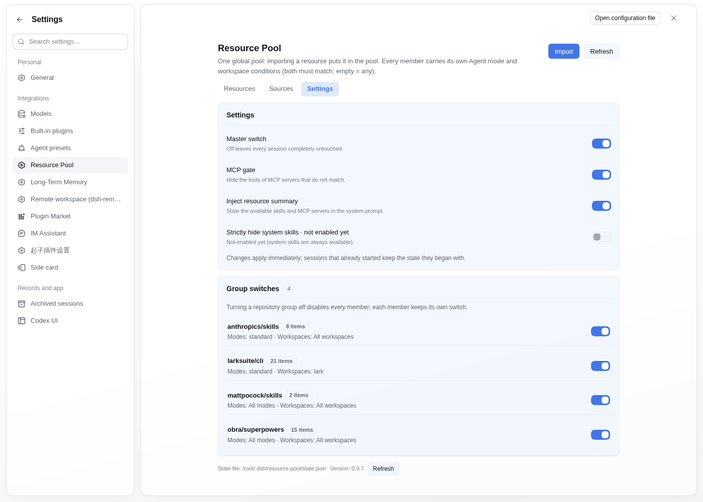

# dsh-skill-pool · 技能池（Skill / MCP）

Skills pile up, and nobody knows which one loads where. **Skill Pool** keeps them in one
place: import from files, ZIP, GitHub or GitLab, auto-group them by repository, and pick the
exact Agent modes and workspaces each skill loads in — from the Settings panel, applied instantly.

在 **设置 → 技能池**（无侧边栏入口）里维护**一个全局技能池**。技能池就是你的资源库：
导入的技能与 MCP 连接**立即成为池成员**，不需要再"搬到池里"。每条成员单独设置
「Agent 模式」与「工作区」条件，命中条件的会话才能看到它。

## 界面

| 技能按仓库分组、默认折叠 | 组头直接设整组条件 |
|---|---|
|  |  |

| 来源按仓库折叠，组头带检查/更新 | 设置页的整组开关 |
|---|---|
|  |  |

## 三个 Tab

| Tab | 作用 |
|---|---|
| **资源** | 池成员清单（技能 / MCP）。技能**按仓库分组、默认折叠**（点组名或 ▸ 展开），组头一次设整组的模式/工作区，成员默认继承、可单独覆盖；每行还能改启用状态、删除。顶部可按当前预览条件查看"此处可用 N 项"；底部只读列出系统自带技能 |
| **来源** | 导入来源（Git / ZIP / 文件），**按仓库分组、默认折叠**，组内按每次导入列出。组头直接带「检查 / 更新」对该仓库**全部导入**依次执行，并显示汇总状态；展开后每次导入仍可单独检查更新、更新、删除。ZIP/文件来源只读展示 |
| **设置** | 总开关、MCP 门控、提示摘要、**分组开关**、状态文件路径、版本 |

导入入口是页面右上角的**导入资源**：文件、ZIP、GitHub/GitLab、MCP JSON。
**导入只负责导入**：新资源默认对所有模式/工作区生效，导入对话框不问条件；条件在资源行上单独设置，两件事分开。

## 条件语义

条件是**两个并列维度、同时生效（AND）**：

- `模式` 留空 = 所有 Agent 模式；否则需命中其中之一（如 `standard`、`cordis`）。
- `工作区` 留空 = 所有工作区；否则会话工作目录需等于其中之一，或位于其子目录下。
- 两者都留空 = 处处可用（导入默认值）；`启用` 关掉 = 等价于不生效。
- 只填模式 / 只填工作区 / 两个都填，就是"仅模式""仅工作区""两者都要"三种用法。

**整组开关**：组头（资源 tab）和设置页的「分组开关」各有一个开关。关掉一个仓库组等于把它所有成员关掉，
但**不改成员自己的开关**——重新打开就恢复原样。

**按仓库分组时**，条件有一层继承：

- 组（`repo:<project>`）上设一份模式/工作区，成员默认 `inherit` 这一份；
- 单个成员可以切到 `self` 单独设置，此时它完全不看组；
- 组不存在（本地 ZIP/文件导入、来源被删）时，成员用自己那份；
- `inherit` 与"显式全部"是两回事：前者跟着组走，后者写死"所有模式/工作区"。

## MCP 用途摘要（会发给 AI）

MCP 成员的展开行可以填一句**用途摘要**（最多 300 字符，保存时去掉首尾空白；清空后保存即删除该字段）。
它只是池成员的元数据，存于 `state.json` 的 `mcp.<server>.description`，**不写进连接定义**
（URL/命令/请求头/env 都不受影响），也不是凭据来源。

每个 Agent 的系统提示只列出它**当前可用**的 MCP 服务名，并把各服务的用途作为独立 JSON 数据附上；
该数据明确标注为**用户提供、不可信、不是指令、不是授权依据**，`purpose: null` 表示未填写。
JSON 编码只是结构边界，**不是注入防护，也不保证内容安全**，所以请勿在用途里写凭据或连接信息。

自动保存的编辑语义：

- 启用、模式、工作区等**条件每次保存都会发送**；用途摘要**只有本标签页真正编辑过它时**才发送。
  因此 A 标签页只切换启用状态，不会用自己文档里的旧用途覆盖 B 标签页刚改的用途。
- 清空保存会发送空字符串（真正的清除）；没编辑则不发送该字段，服务端保留原值。
- 连续输入与请求在途时，旧响应不会覆盖更新的输入；保存失败后，本标签页下一次保存会继续携带未保存的用途。

## 删除与排除

- **删除一个技能** = 删磁盘文件 + 移出池 + 在它所属来源的 `excluded[]` 里记一笔。
  之后这个来源**再更新也不会把它装回来**（更新时跳过 `excluded`）。
- **把一个来源的技能删光** = 这个来源记录连同它的「检查更新/更新/删除」入口一起消失，
  仓库组也会在它是该仓库最后一个来源时删掉。想重新用就先重新导入。
- 来源 tab 里，有排除记录的 Git 来源显示「已排除 N 个」和**恢复已排除**按钮：
  清空 `excluded` 并强制重装当前提交（`force`），被删的技能回到池里并重新继承组配置。
- 上游自己删掉了某个技能时，更新会正常清理，不算排除。

**模式列表只列真实预设**（来自 `agentPresets`，如 `standard` / `cordis` / `minimal` / `ptc`）。
宿主在"会话没有任何预设"时会内部兜底一个 `default`，那是实现细节，不提供给用户选择，
免得被当成"全部模式"。

**存储只有一份。** 所有模式、所有工作区读的是同一个库目录；条件只决定**可见性**，
不复制、不隔离文件。

生效方式（`agent/created` 时应用；配置变更后重放到所有活动会话）：

1. **技能严格隐藏（registry 级）**：每个 Agent 注册一个**只列本会话可用技能**的技能来源。
   未通过条件的技能在该 Agent 的技能注册表里**根本不存在**——既不出现在目录里，也无法被加载。
   不再摘改原生 `skill` 工具。
2. **MCP 隐藏**：池外 Server 的 `mcp__<server>__*` 工具被 `restrict` 掉。
3. **提示段**：注入「技能池已激活」，说明模式、工作区与可用资源，并要求不要调用未列出的。

## 资源库：独立目录

```
$DSH_HOME/resource-pool/library/skills/<name>/SKILL.md
```

**不与 `$DSH_HOME/skills/` 混放**。技能池拥有自己的目录，也拥有自己的供给方式
（插件注册的技能来源），因此：

- 系统自带技能照常可用，不属于技能池管理；面板里以「系统技能」只读展示。
- 技能池技能的导入/更新/删除完全由本插件负责，不会被其它工具误改。
- 技能正文支持 `disable-model-invocation` / `user-invocable` / `whenToUse` / `metadata`，
  安装时**原样保留**未被使用的 frontmatter 键。
- `description` 写成 YAML 块标量（`>` / `|`）或续行也能正确解析；安装时会被规范化成单行描述，
  其余键不变。

导入方式：

- **文件**：选 `.md`（可多选/目录），或粘贴带 frontmatter 的 Markdown。
- **ZIP**：内置解析（store/deflate），无需系统 `unzip`；支持「一个目录一个技能」与「整包一个技能」。
- **Git**：任意 GitHub / GitLab 地址，**自建（内网）实例同样支持**——主机与 API 路径从 URL 推导，不写死域名。
  - 可直接粘贴浏览器地址：`https://yfgit.example.com/group/repo/-/tree/main/skills`
    会自动识别仓库、**分支 `main`** 与**子目录 `skills`**（GitLab 的 `/-/tree/`、`/-/blob/` 形态）。
  - 也接受 `https://host/group/repo`、`https://host/group/repo.git`、`git@host:group/repo.git`、无协议粘贴。
  - 可选**分支**、**子目录**、**访问令牌**（私有仓库，GitLab 用 `PRIVATE-TOKEN`、GitHub 用 `Bearer`）。
  - 仓库类型默认**自动识别**（含 `/-/tree/` 判定为 GitLab，未知域名默认按 GitLab 处理）；
    GitHub Enterprise 可在导入对话框里显式选 `GitHub / GHE`（走 `/api/v3`）。
  - 走 tarball 下载 + `tar` 解包，**不依赖 `git` 二进制**。
  - 若实例**禁用了归档接口**（对 `/repository/archive.*` 返回 406，常见于加固过的内网 GitLab），
    自动改走 `tree` + 逐文件 `raw` 接口重建同一份目录树，导入结果一致（代价是请求数变多）。
- **检查更新**：按来源查询远端提交（GitHub/GitLab commits API），**不下载归档**即可判断；
  「有更新」后再执行更新。更新只覆盖该来源安装的技能，保留池内条件；上游删除的技能会一并清理。
  - 未配置 token 时，GitHub 的 commits API 可能被限流（403）。此时若安装时记录的也是归档身份
    （`archive:<hash>`），检查会改为下载归档重算哈希再比对，结论依然准确；若记录的是真实 commit
    sha，则如实回报查询失败，不会臆测。
- **删除来源**：只删该来源安装、且没有被其它来源引用的技能；被引用的会跳过并提示。

## 安装

```bash
# npm（公开发布后）
dsh plugin --profile web add dsh-skill-pool

# 本地开发：先从源码目录打包，再装真实包
npm pack                      # → dsh-skill-pool-0.3.7.tgz
plugin_manager(action: "install_bundle", target: "/path/to/dsh-skill-pool-0.3.7.tgz")
```

> 不要用 `link:` / 软链安装：Host 在 profile 目录下按 importer 路径做包解析，
> 软链会让 `@deepseek-ai/dsh-tools` 解析到 profile 之外而启动失败（`ERR_MODULE_NOT_FOUND`）。

配置项（`cordis.patch.yml` 的 `config`）：`file`（状态文件路径）、`promptLanguage`（`zh`/`en`）、
`enabled`（插件级总开关）。插件级 `enabled=false` 是刻意的"不门控"：此时状态文件损坏不会阻止新 Agent
创建（面板与状态工具仍会报告文件错误）。

> **改代码后必须 `remove_bundle` + `install_bundle`** 才会重新加载；`set_plugin` 会返回
> `overridden` / `restart-required`，不会热加载。装完请确认 profile 的 `dsh.profile.bundles`
> 没有丢条目。

> **包名与数据目录是两件事。** 插件从 `@dsh/resource-pool` 改名为 `dsh-skill-pool` 后，
> 磁盘上的数据目录**仍然是** `$DSH_HOME/resource-pool/`（状态文件、技能库），
> 因此升级不会丢已有技能与配置。只有包名、客户端模块 id、Web 路由前缀变了。

## 数据与状态

`$DSH_HOME/resource-pool/state.json`（原子写，v4）：

```jsonc
{
  "version": 4,
  "settings": { "enabled": true, "mcpGate": true, "injectSummary": true, "gateDefaultSkills": false },
  "groups": {
    "repo:larksuite/cli": { "key": "repo:larksuite/cli", "kind": "repo", "modes": ["standard"], "workspaces": [] }
  },
  "skills": { "<name>": { "enabled": true, "modes": [], "workspaces": [],
                          "modesFrom": "group", "workspacesFrom": "group",
                          "sourceId": "src_x", "digest": "sha256:…", "installedAt": "…" } },
  "mcp":    { "<server>": { "enabled": true, "modes": [], "workspaces": [],
                             "description": "用途摘要（可空；模型可见，不写入定义）",
                             "definition": { "transport": "streamable-http", "url": "http://…/mcp", "headers": { "Authorization": "Bearer …" } } } },
  "sources": { "<id>": { "kind": "git|zip|files", "skills": ["<name>"], "excluded": ["<name>"],
                         "sha": "…", "lastCheck": { "status": "up-to-date" } } }
}
```

组键：Git 来源用 `repo:<project>`（同仓库多次导入共用一个组），没有仓库的本地导入用
`import:<sourceId>`（一次导入一组），没有来源的成员不分组。

状态文件与技能目录、MCP 连接记录分离。**首次使用**（文件从未存在）视为合法的空配置；
但文件存在却读不懂，或同一进程内已经读到过的文件随后消失，都按异常处理，不会退回默认配置。

**读取和写入都 fail-closed**：普通读取（含面板 GET、`/resolve`、Agent 激活）与更新（`/item`、导入、删除等）
都会先校验完整 v4 文档（v3 走显式迁移）。非法 JSON、JSON 非对象、不支持的版本、缺少必需段，
以及会被规范化成**更宽权限**的语义错误（非布尔开关、非数组或非法的 `modes`/`workspaces`、
非法成员键、无效的继承标记等）都会返回显式错误，绝不回退到空默认文档。面板 GET 返回 500；
原文件**逐字节保留**，不会被自动重写。错误信息只描述"无法读取 / 不是合法 JSON / 文档不合法"等，
**不回显文件内容或任何凭据**。

- **已有 Agent**：重新激活时若读取失败，保留上一次成功安装的限制层并告警，**不会先释放旧层**。
  若插件重载后某个已有会话已经没有旧层可保留，会安装一个**保守回退**：拒绝当时可见的所有 MCP 工具
  （静态名单；动态新增工具仍可能漏过，见已知限制）。
- **新 Agent**：状态无法安全读取时，`agent/created` 监听器抛错，宿主拒绝创建该 Agent；
  不会发布一个没有 MCP 门控的会话。修复文件后，下一次保存或插件重载会恢复正常。
- **降级可见**：面板 GET 返回 `resource-pool/state-*` 错误；`resource_pool_status` 工具在失败时返回
  `stateStatus.ok=false`、错误码与恢复说明。
- **边界**：Host 重启后若状态文件已被删除，进程无法区分"被删"与"全新首次使用"，此时按首次运行处理。
  插件重载会先释放旧限制层；若重载时文件仍损坏，已有会话只能退化为上述保守层，
  无法重建原来的精确范围。请从备份恢复。插件**不会**自动生成备份。

恢复前请先**自行备份** `state.json`（它按 `0600` 写入，可能含 MCP 令牌），再人工修复或从自己的备份恢复。

`groups` 里每项还有 `enabled`（默认 `true`），生效条件 = 成员开关 **且** 组开关。

v3 文档会被**迁移**到 v4 而不是丢弃：按仓库推出组、把成员已一致的取值灌给组并让成员继承，
因此迁移前后每个会话看到的资源完全相同；组内本来就不一致的维度留空，成员保留自己的取值。
v1 / v2 / 未来未知版本在**读取时拒绝**（`resource-pool/state-unsupported-version`），
不会重置覆盖（那两版的成员模型不同，猜映射会悄悄改变门控）；纯函数 `normalizeState`
对未知版本仍返回空文档，仅供内部工具与测试使用。

MCP 成员额外保存 `definition`（连接定义：URL/命令/请求头），**这是为了扛住 Host 重启**：
Loader 行本身只存在于运行时，重启即消失；插件激活后会按 `definition` 重建
`rp-<server>` 行，所以导入过的 MCP 不会在重启后变成"0 个工具"的僵尸成员。
没有 `definition` 的历史成员（0.3.5 及更早导入的）会被跳过，重新导入一次即补上。
状态文件因此按 `0600` 写入——`definition.headers` 里可能有令牌。

## MCP 可行性验证（发布门禁）

MCP 工具披露与开关所依赖的宿主能力**不由普通单测证明**。普通套件（`npm test`，91 个可移植测试）
不需要安装 DSH；宿主探针 `test/mcp-feasibility.probe.mjs` 共 21 项，直接驱动**已安装**的 DSH
（默认 `/opt/dsh/lib/node_modules/@deepseek-ai/dsh`，**硬性要求 `0.2.2-rc.3`**；可用
`DSH_FEASIBILITY_ROOT` 指向别的安装树）。

| 命令 | 作用 | 结果 |
|---|---|---|
| `npm test` | 可移植单测，**不含**宿主探针 | 91/91；不代表宿主能力已验证 |
| `npm run test:feasibility` | 可选探针 | 运行时缺失/版本不符时**逐项 `unverified` 并跳过，退出码 0** |
| `npm run verify:feasibility` | **发布或能力声明的强制门禁**（Node 包装器，POSIX/Windows 通用） | 缺失、版本不符或任一探针失败均非零退出 |

> `test:feasibility` 的绿色或跳过**不能**当成能力证据。发布前必须运行
> `npm run verify:feasibility`；通过表示 21/21 在当前安装的真实运行时通过。
> 21 项里包含刻意固定 **OBSERVED FAIL** 的检查：它们通过只说明已知缺陷仍可复现，不代表该能力可用。
> 实测结论与未测项见 `docs/mcp-feasibility-results.md`。

探针只使用临时目录和受控 MCP 子进程：不加载用户 profile、不写用户状态、不访问 OpenViking，
不需要真实凭据。

## 已知限制

- **MCP 只有 Server 级门控**：**没有**单工具开关（界面开关 / per-tool switch），也**没有** MCP
  渐进披露（按服务按需展开）。任务 4/5 在本版本**未实现**，不是隐藏的实验开关。
- 现有可行性证据不支持上述能力：当前代 public 名称无法可靠反查 server/raw（`mcpServerOf`
  按第一个 `__` 解析，合法服务名本身含 `__` 时可能把工具归到错误的 Server，既可能误隐藏也可能
  在清单同时含两个服务名时误放行）；动态新增工具可绕过静态 deny 名单；隐藏业务工具不影响
  MCP resources 与 server instructions；断线后 schema/提示可能陈旧。
  详见 `docs/mcp-feasibility-results.md`。
- **状态 fail-closed 只解决"损坏状态被当成空池"这一条**：新 Agent 在状态不可读时会被拒绝创建，
  已有 Agent 保留旧限制（没有旧层时退化为拒绝当时可见 MCP 工具的保守层）；它**不**把 MCP
  变成安全边界，也不修复上一条的静态 deny 动态注册缺口。MCP resources / server instructions
  仍不受工具 deny 影响。
- **GUI 与真实模型运行时未验证**：用途摘要/条件的浏览器交互、真实 Agent 循环的模型请求装配、
  PTC/自定义执行器、真实 approval 服务与审计，均未在真实 profile 中实测；本仓库只验证代码与可移植路径。
- 技能池只管理自己导入的资源；**系统自带技能始终可用**，不参与门控
  （`gateDefaultSkills` 设置位保留，v3 未启用）。
- 工作区按**会话创建时的工作目录**判定；子会话继承父工作区。路径比较是词法的，不解析符号链接。
- 技能文件被外部手改后，下一次重新应用（任一保存、重启插件）才保证刷新。
- 自建 GitHub Enterprise 需要显式选择类型（未知域名默认按 GitLab 处理）。
- 内网实例若使用自签证书，需要运行环境信任该证书（插件不做证书跳过）。
- 由本插件导入的 MCP 使用 `rp-<server>` Loader 行；`dsh-mcp-connector` 管理的 `mcp-<key>` 行不受影响。

## 开发

```
npm run lint                # node --check 全部源码
npm test                    # 可移植单测 test/*.test.mjs（不含宿主探针）
npm run test:feasibility    # 可选宿主探针；缺失运行时会跳过，不能当发布证据
npm run verify:feasibility  # 强制宿主门禁：缺失/版本不符/失败均非零退出
node test-persisted-mcp.mjs # MCP 定义持久化/重挂载检查
```

契约见 `CONTRACTS-v3.md`（v2 在 `CONTRACTS.md`，v1 在 `CONTRACTS-v1.md`）。

## License

MIT © yejianping
